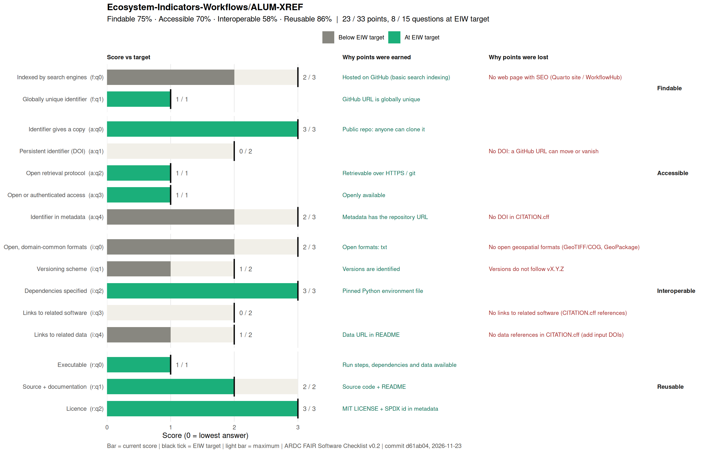

<!-- README.md is generated from README.qmd. Please edit that file -->

# Adjusting cross-references of modified Australian terrestrial ecosystems to the IUCN Global Ecosystem Typology

**Version:** 0.1.0  
**Release Date:** 2026-11-21  
**Dataset License:** [CC BY
4.0](https://creativecommons.org/licenses/by/4.0/), with source spatial
data attribution to Australian Land Use and Management Classification
(V8) and Land Use of Australia layers (V7.1), Australian Bureau of
Agricultural and Resource Economics and Sciences, Canberra, under:
Creative Commons Attribution 4.0.  
**Code License:** MIT  
**Workflow Repository:**
<https://github.com/Ecosystem-Indicators-Workflows/ALUM-XREF>

> *Note: This `README.md` is dynamically generated from
> [`README.qmd`](README.qmd). The dataset README with the statistics of
> the output GeoTIFFs and CSV tables is in
> [`results/output1-best-candidate-raster/`](results/output1-best-candidate-raster/README.qmd);
> to update it after regenerating the data, run
> `quarto render results/output1-best-candidate-raster/README.qmd`.*

------------------------------------------------------------------------

## Funding

This work is supported by:

- The **ARC Industry Laureate Fellowship Project** *“Foundations for
  leading the nature positive ecosystem conservation agenda”*
  ([IL240100030](https://dataportal.arc.gov.au/NCGP/Web/Grant/Grant/IL240100030))
  led by Professor David Keith at UNSW Sydney, in partnership with the
  Department of Climate Change, Energy, the Environment and Water,
  International Union for Conservation of Nature (IUCN), Department of
  Energy, Environment and Water, Department of Biodiversity,
  Conservation and Attractions, Department of Planning and Environment
  NSW, and Department of Natural Resources and Environment Tasmania.
- The **[Ecosystem Indicators Workflows
  (EIW)](https://doi.org/10.3565/j5sq-a757)** project, which received
  investment from the **Australian Research Data Commons (ARDC)**. The
  ARDC is funded by the **National Collaborative Research Infrastructure
  Strategy (NCRIS)**.

## Author contributions

- **José R. Ferrer-Paris** (ORCID:
  <https://orcid.org/0000-0002-9554-3395>) — *Centre for Ecosystem
  Science, UNSW Sydney; IUCN Commission on Ecosystem Management*
- **David A. Keith** (ORCID: <https://orcid.org/0000-0002-7627-4150>) —
  *Centre for Ecosystem Science, UNSW Sydney; IUCN Commission on
  Ecosystem Management*

**Author Contributions:** For
[IL240100030](https://dataportal.arc.gov.au/NCGP/Web/Grant/Grant/IL240100030):
DAK is project lead and JRFP is workpackage lead (workflow development).
For [Ecosystem Indicators Workflows
(EIW)](https://doi.org/10.3565/j5sq-a757): JRFP is project lead.

------------------------------------------------------------------------

## About this workflow

This repository applies available cross-referencing information to the
*Australian Land Use and Management Classification* (version 8) and the
*Land use of Australia* layers for 2010–11 to 2020–21 (version 7.1).
This provides a layer of information about the extent of antropogenic
Ecosystem Functional Groups (EFGs, Level 3) of the IUCN Global Ecosystem
Typology \[IUCN GET; Keith et al. (2022)\]. This layer can be used in
compination with other layers to produce extant layers for natural and
antropogenic ecosystem in Australia. This workflow cleans and checks the
tables, produce the overlay layers and combines them with other data to
produce the extant distribution maps at 90 m.

## Repository Structure

The figure shows where things are (the workflow writes into
`data/processed_data/`, `data/metadata/` and `results/`):

``` text
NSWPCT-XREF/
├── data/
│   ├── xrefdata/      
│   ├── source-data/   
│   ├── processed_data/
│   └── metadata/                  
├── scripts/
│   ├── workflow_*.R               
│   └── functions.R                  
├── results/
│   ├── output1-landuse-overlay/   
│   └── template-zenodo.json, template-datapackage.json
└── logs  
├── references/  docs-src/  docs/  assets/
├── fair/  .fair/  .github/          FAIR checklist assessment (updated by GitHub Actions)
└── CITATION.cff  codemeta.json  LICENSE  README.qmd  _quarto.yml
```

- `data/xrefdata/`: expert membership tables.
- `data/source-data/`: source datasets, downloaded from multiple sources
  (ignored by Git).
- `data/processed_data/`: cleaned or processed data.
- `data/metadata/`: provenance of the input files md5sum check files.
- `scripts/`: `workflow*.R` (workflow scripts) and `functions.R` (custom
  functions).
- `results/`: output datasets; one folder for each output.
- `references/`, `docs-src/`, `docs/`, `assets/`: references,
  documentation sources and assets. Core bibliographic references are
  recorded in `references/main.bib`, including commented sections for
  main references and for software references. Case-study specific
  references are to be recorded in `references/additional.bib`,
  including sections for data sources and other case-study specific
  references.
- `fair/`, `.fair/`: FAIR software checklist assessment, updated by
  GitHub Actions after merges to `main`.
- `logs`: log files from console outputs, reproducibility log.

## Inputs

| Input | Citation | Persistent link |
|----|----|----|
| NSW natural EFGs | Tozer et al. (2026) | [](https://doi.org/10.5281/zenodo.24398850) |
| Crosswalks ALUM to IUCN GET | Macfarlane et al. (2024);Macfarlane et al. (2025) | [](https://doi.org/10.25919/qy5a-zj69) |
| Land Use of Australia layers (V7.1) | ABARES (2026) | [](https://doi.org/10.25814/n0z4-5y98) |

## Outputs

All workflow outputs are written to the `./results/` directory, with
each key output dataset in its own subdirectory. The `./results/`
directory is ignored by Git, but each subdirectory contains a
`README.qmd` file that is committed to the repository. The `README.md`
files are dynamically generated from the output datasets and contain
summary statistics, metadata, and references for each dataset.

Published outputs:

| Output | Citation | Persistent link |
|--------|----------|-----------------|
| NSW    | TO DO    | TO DO           |
| AUS    | TO DO    | TO DO           |

## References

<div id="refs" class="references csl-bib-body hanging-indent"
entry-spacing="0">

<div id="ref-ALUM_2026" class="csl-entry">

ABARES. 2026. “<span class="nocase">Land use of Australia 2010–11 to
2020–21</span>.” Canberra: Australian Bureau of Agricultural and
Resource Economics and Sciences. <https://doi.org/10.25814/n0z4-5y98>.

</div>

<div id="ref-Keith_2022" class="csl-entry">

Keith, David A., José R. Ferrer-Paris, Emily Nicholson, Melanie J.
Bishop, Beth A. Polidoro, Eva Ramirez-Llodra, Mark G. Tozer, et al.
2022. “A Function-Based Typology for Earth’s Ecosystems.” *Nature* 610
(7932): 513–18. <https://doi.org/10.1038/s41586-022-05318-4>.

</div>

<div id="ref-Macfarlane_2024" class="csl-entry">

Macfarlane, Craig, SJD Cox, RJ Francis, R Jordan, DA Keith, RT
Kingsford, N Liu, et al. 2024. “Methods for Developing Spatial Extent of
IUCN Ecosystem Functional Groups at 250 m Resolution for Freshwater,
Terrestrial, Marine and Transitional Realms for Australia: Pre-1750,
2010-11, 2015-16 and 2020-21. A Report for the National Ecosystem
Accounting Project.” Australia: CSIRO.
<https://doi.org/10.25919/13nv-pm70>.

</div>

<div id="ref-Macfarlane_2026" class="csl-entry">

Macfarlane, Craig, Ning Liu, Glenn Newnham, Anna Richards, and Sally
Tetreault Campbell. 2025. “<span class="nocase">Extent of IUCN Global
Ecosystem Typology ecosystem functional groups across the marine,
freshwater and terrestrial realms in Australia: pre-1750 and 2010-11 to
2023-24</span>.” Australia: CSIRO. <https://doi.org/10.25919/qy5a-zj69>.

</div>

<div id="ref-tozer_2026_24398850" class="csl-entry">

Tozer, Mark G., José R. Ferrer-Paris, Abhimanyu Raj Singh, Elliot Gould,
and David A. Keith. 2026. “Cross-Referencing New South Wales Plant
Community Types (PCTs) to the IUCN Global Ecosystem Typology: 90m
Best-Candidate Spatial Synthesis.” Zenodo.
<https://doi.org/10.5281/zenodo.24398850>.

</div>

</div>

<!-- FAIR:START -->
## FAIR assessment

[](https://fairsoftwarechecklist.net/v0.2?f=21&a=30112&i=21301&r=123) 

**23 / 33 points · 8 / 15 questions at EIW target** · not yet at EIW minimum

| Principle | Score | EIW target |
|---|---|---|
| Findable | 3 / 4 (75%) | 4 / 4 |
| Accessible | 7 / 10 (70%) | 10 / 10 |
| Interoperable | 7 / 12 (58%) | 12 / 12 |
| Reusable | 6 / 7 (86%) | 6 / 7 |

<details><summary>Gaps to close (7)</summary>

- **f:q0 Indexed by search engines** (2 / 3): No web page with SEO (Quarto site / WorkflowHub)
- **a:q1 Persistent identifier (DOI)** (0 / 2): No DOI: a GitHub URL can move or vanish
- **a:q4 Identifier in metadata** (2 / 3): No DOI in CITATION.cff
- **i:q0 Open, domain-common formats** (2 / 3): No open geospatial formats (GeoTIFF/COG, GeoPackage)
- **i:q1 Versioning scheme** (1 / 2): Versions do not follow vX.Y.Z
- **i:q3 Links to related software** (0 / 2): No links to related software (CITATION.cff references)
- **i:q4 Links to related data** (1 / 2): No data references in CITATION.cff (add input DOIs)

</details>



<sub>Updated 2026-11-23 from commit `d61ab04` by `.fair/fair_check.R`. Edit `.fair/fair-checklist.yml`, not this block.</sub>
<!-- FAIR:END -->
